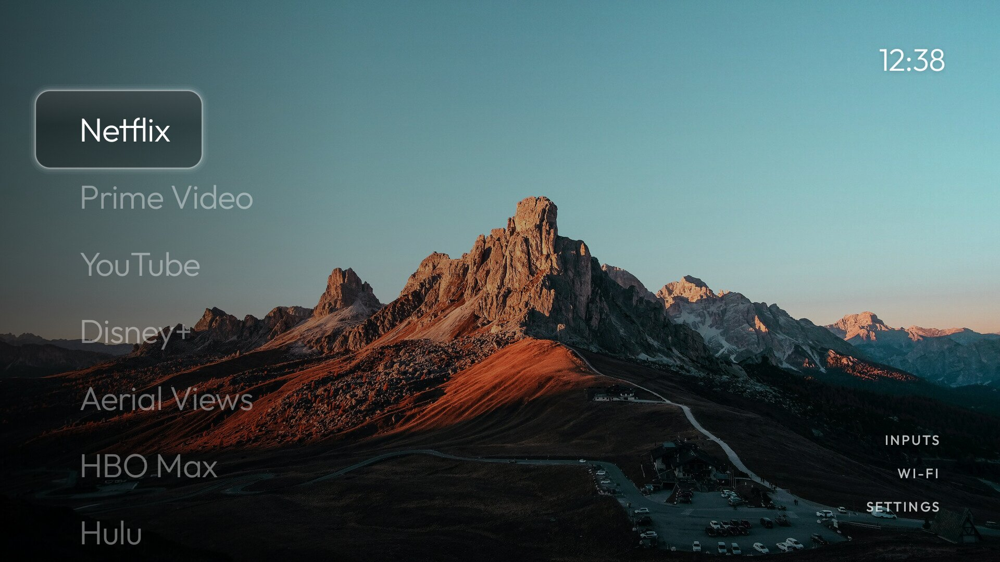

# glass-tcl-tv-launcher

A quiet home screen for a TCL Google TV: a photograph, the time, and a left-aligned list of apps
that the remote walks down. One glass pill springs between rows; long-press a row to rearrange, and
a settings screen switches between the list and a dock, three pill materials and glyphs-or-names.

Modelled on [CleanFrame](https://github.com/nthnclrk/CleanFrame) (Samsung Tizen, HTML/CSS), rebuilt
as a native Android launcher. Code derived from [tv-vibehack](https://github.com/Gathin23/tv-vibehack).
Attribution and asset credits: [NOTICE.md](NOTICE.md).



## The TV

| | |
| --- | --- |
| Hardware | TCL smart TV, Android TV 12 (SDK 31), 4K panel with the UI overridden to 1920×1080 @ 320dpi |
| Package | `me.damon.glasshome` |
| Replaces | the stock Google TV launcher, or any third-party launcher |

## Everything is a Gradle task

Requires JDK 25 (or 17), the Android SDK (platform 36, build-tools 36), and `adb`. No Python, no
Node, no wrapper scripts.

```sh
cd launcher

./gradlew generateGlyphs   # SVGs in glyphs/ -> res/drawable/glyph_*.xml
./gradlew testDebugUnitTest  # 17 JVM tests (Robolectric), ~11 s, no device
./gradlew tvInstall        # build + install on the TV
./gradlew tvLaunch         # open it
./gradlew tvHome           # make it the Home app
./gradlew tvTest           # 7 instrumented tests, on the TV
./gradlew tvScreenshot     # save the current screen to app/build/screen.png
./gradlew tvDebloat        # apply examples/<tv>/debloat.txt
./gradlew tvRestore        # undo it
```

The TV usually sits on a different VLAN than this Mac, so `tvConnect` (a dependency of every `tv*`
task) forwards a local port to the set through an SSH host that can reach it, then points `adb` at
that port. Override the defaults with `-P`:

```sh
./gradlew tvInstall -PtvIp=192.168.1.50 -PtvRouter=my-router
```

Revert Home to a previous launcher at any time:

```sh
adb shell cmd package set-home-activity --user 0 <old.package>
```

## Configure it

`app/src/main/res/values/config.xml`:

| Setting | Meaning |
| --- | --- |
| `home_apps` | Seed order: pinned first, everything else alphabetical. |
| `hidden_apps` | Never listed (the Live TV tuner is covered by the Inputs menu). |
| `live_tv_package` | Appended to the Inputs dropdown. |
| `show_icons` / `glass_icons` | Names only, or white glyphs extracted from the app icons. |

Once you rearrange the list on the TV, that order is stored in `SharedPreferences` and wins over
`home_apps`.

Bundled glyphs live in `glyphs/*.svg`; add one there and run `./gradlew generateGlyphs`, then map
the package to it in `ui/IconLibrary.kt`.

## How it is put together

Single source of truth, no DI framework:

```
GlassHomeApplication  ->  AppContainer  ->  HomeRepository  (StateFlow<HomeState>)
                                                 |
                        HomeViewModel / SettingsViewModel  (collect, expose state)
                                                 |
                        MainActivity / SettingsActivity  (render, forward input)
```

`HomeRepository` owns the installed-app scan, the saved order and the appearance choices.
`SettingsActivity` writes to it; `MainActivity` collects from it, so a change made in settings is the
state the home screen resumes with — no re-reading preferences in `onResume`.

```
launcher/app/src/main/kotlin/me/damon/glasshome/
├── GlassHomeApplication.kt      application + tiny container
├── data/
│   ├── AppOrder.kt              saved order of the list
│   ├── HomeSettings.kt          appearance storage
│   └── HomeRepository.kt        scan + state
├── model/                       AppEntry, AppSorter, Appearance/HomeState
├── ui/home/                     MainActivity, HomeViewModel, AppListAdapter
├── ui/settings/                 SettingsActivity, SettingsViewModel
└── ui/                          GlassPill*, GlyphIcons, IconLibrary, CornerLinks,
                                 ConnectionLabel, InputsMenu, RemoteLongPress

launcher/app/src/test/           JVM tests (Robolectric)
launcher/app/src/androidTest/    instrumented tests, run on a device
```

## Settings screen

Corner link **SETTINGS** → Up/Down between rows, Left/Right between choices, OK to apply.

| Option | Values |
| --- | --- |
| Layout | `List` (left column) · `Dock` (row along the bottom, links move under the clock) |
| Material | `Glass` · `Clear` · `Solid` |
| Icons | `Glyphs` (bundled white logos) · `Names` |
| System | opens the Android settings |

## Licence

MIT — see [LICENSE](LICENSE). Upstream copyrights and asset credits are in [NOTICE.md](NOTICE.md).
