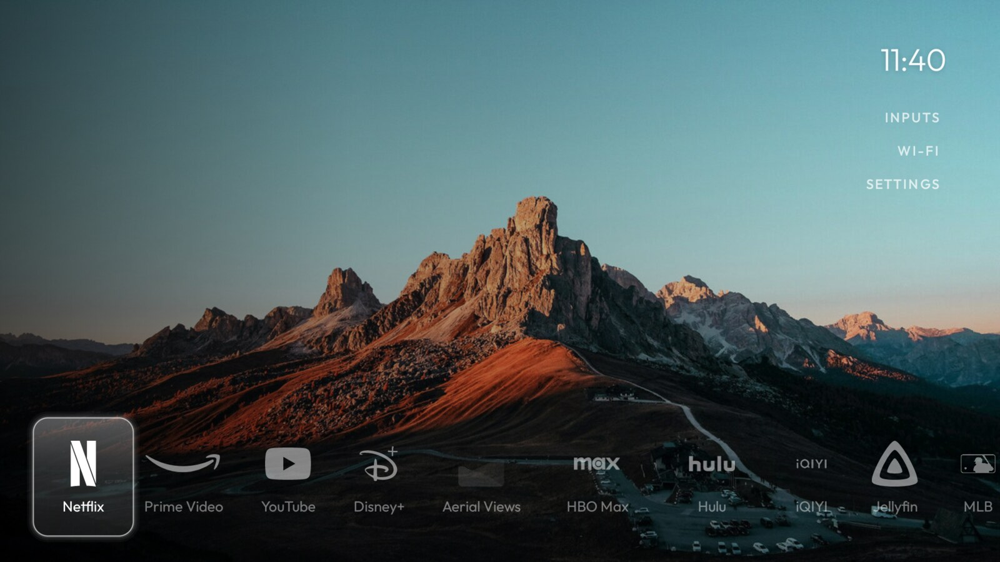
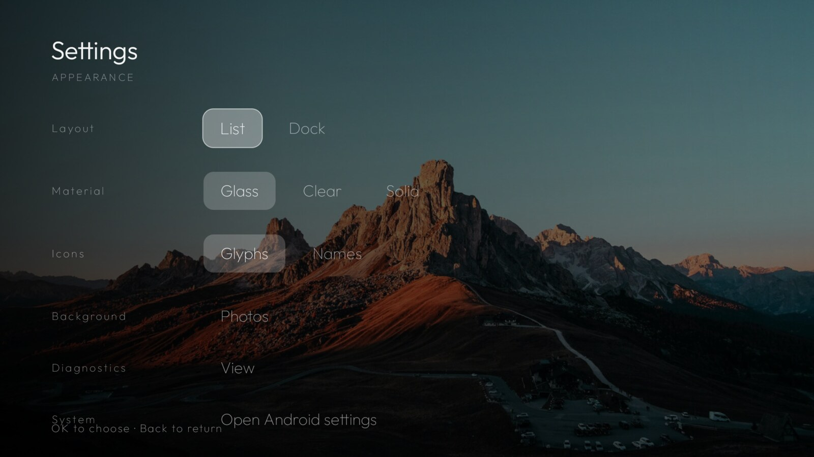
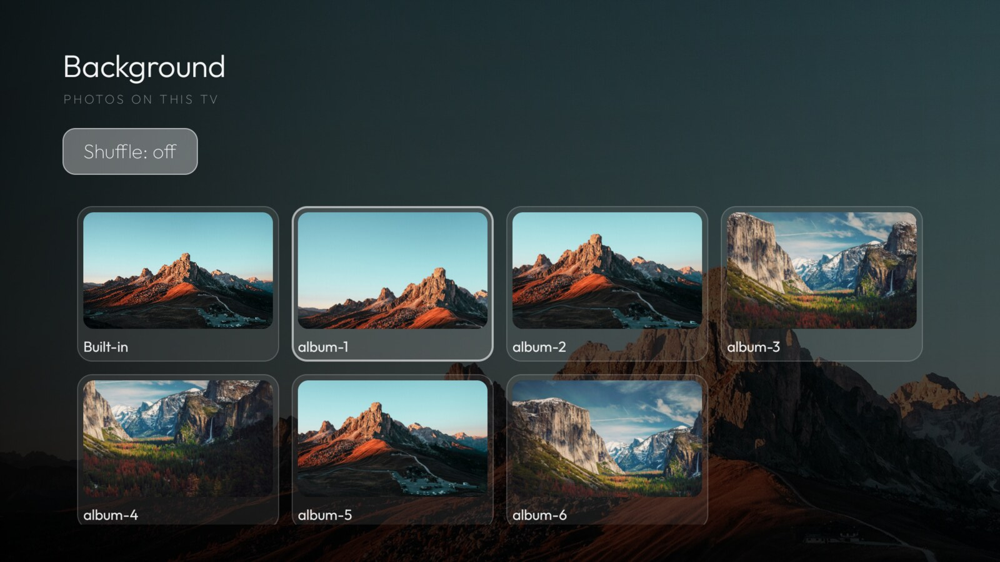
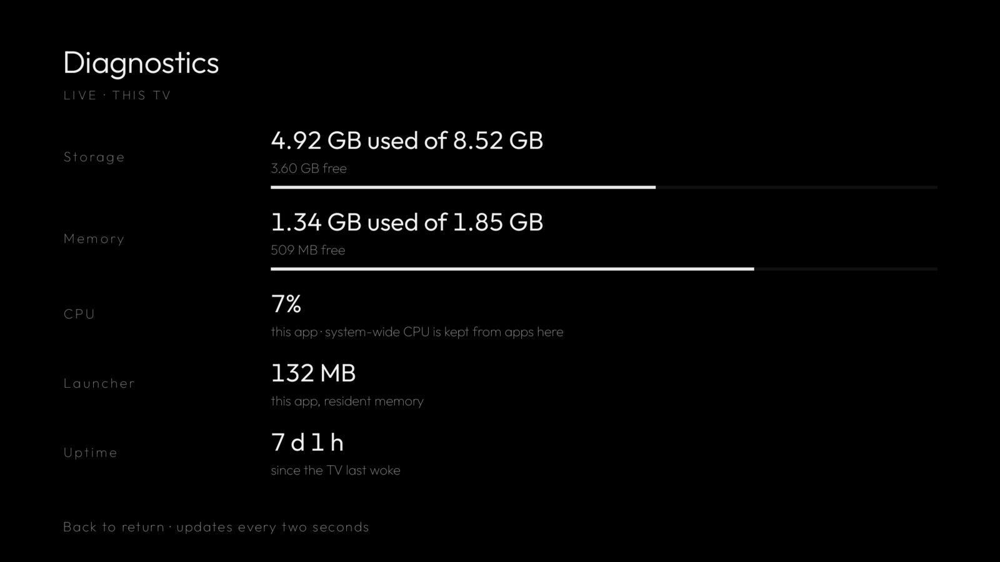

# glass-tcl-tv-launcher

A quiet home screen for a Google TV: a photograph, the clock, and a left-aligned list of apps that
the remote walks down. A glass pill springs from row to row. Long-press to rearrange, and a settings
screen switches the layout, the pill material and whether icons are shown as logos or not.

Native Android in Kotlin, no WebView. Modelled on [CleanFrame](https://github.com/nthnclrk/CleanFrame)
(Samsung Tizen, HTML/CSS) and rebuilt for Android TV. Code derived from
[tv-vibehack](https://github.com/Gathin23/tv-vibehack); asset credits are in [NOTICE.md](NOTICE.md).


## What it does

- **A photograph instead of a wall of ads.** Yours if you want, otherwise the bundled one.
- **The list is the whole interface.** Up and down with the remote, OK to open, long-press OK to
  rearrange. The order is remembered.
- **Corner links** for Inputs, Wi-Fi and Settings, so nothing else needs a home screen icon.
- **Dock layout** if you would rather have a row of tiles along the bottom.
- **Bundled brand glyphs** for the usual streaming apps, with a masked app icon and then a monogram
  as fallbacks. Nothing is drawn from a bitmap that cannot be read.
- **Diagnostics** so you can see what the television is actually doing.

| Dock layout | Settings | Background | Diagnostics |
| --- | --- | --- | --- |
|  |  |  |  |

The screenshots show the bundled Unsplash photograph. Your own album is picked from the TV and never
leaves it; see [your own photos](#your-own-photos).

## Install it on your TV

You need a computer with `adb` (macOS: `brew install android-platform-tools`), a JDK (17 or newer)
and the Android SDK. The build asks for a JDK 25 toolchain and Gradle will fetch one if necessary.

### 1. Let the TV accept a connection

1. Settings → System → About → click **Android TV OS build** seven times. Developer options appear.
2. Settings → System → **Developer options** → turn on **USB debugging** and, if it exists,
   **Network debugging** (`adb` over the network, port 5555).
3. Settings → Network & Internet → note the TV's IP address.

### 2. Connect to it

```sh
adb connect 192.168.1.50:5555     # the address from step 3
adb devices                       # the TV should be listed
```

If `adb devices` says `unauthorized`, accept the prompt on the TV. Keep the TV awake while you work;
a TCL set drops the `adb` port when it goes to standby.

### 3. Build and install

```sh
cd launcher
./gradlew :app:installDebug
adb shell am start -n me.damon.glasshome/.ui.home.MainActivity
```

### 4. Make it the Home app

```sh
adb shell cmd package set-home-activity --user 0 me.damon.glasshome
```

Pressing Home once and choosing **Always** does the same thing.

### Undo it

Your previous launcher is untouched, so reverting is one command. List the launchers on the TV with:

```sh
adb shell cmd package query-activities -a android.intent.action.MAIN -c android.intent.category.HOME
```

then point Home back at one of them:

```sh
adb shell cmd package set-home-activity --user 0 <the.old.package>
adb uninstall me.damon.glasshome
```

### If the TV is on another network

`adb connect` needs a route to the TV. When the television sits on an isolated VLAN (mine does), the
`tv*` Gradle tasks forward a port through an SSH host that can reach it and point `adb` at that port:

```sh
./gradlew tvInstall -PtvIp=192.168.10.208 -PtvRouter=my-router
```

## Using it

| Where | What |
| --- | --- |
| Home, list | Up/Down move, OK opens, long-press OK picks a row up |
| Rearranging | Up/Down move the row, OK drops it, Back cancels the move |
| Corner links | INPUTS opens the source list, WI-FI opens the system Wi-Fi page, SETTINGS |
| Settings | Up/Down between rows, Left/Right between choices, OK applies, Back returns |

Settings has five rows: **Layout** (List or Dock), **Material** (Glass, Clear, Solid), **Icons**
(Glyphs or Names), **Background** (the photo picker) and **Diagnostics**, plus a shortcut to the
Android settings themselves.

## Your own photos

The background can be your own photographs. They live on the TV, in the launcher's own folder, so
personal photos never enter this repository:

```sh
cd launcher
./gradlew tvWallpapers -Pphotos="$HOME/Pictures/trips"
```

Each photo is resized to 1920x1080, centre cropped and pushed over the same connection the other
tasks use. Then open **Settings → Background → Photos** on the TV: the grid offers **Built-in** and
every photo in the album, and **Shuffle** changes the background after you have been away for a while
(returning from Settings does not count). Choosing a photo by hand switches Shuffle off, so a picture
you picked stays picked.

Sizes measured on this set: about **240 KB per photo**, because the launcher renders at 1920x1080
(the UI is composed at 1080p and scaled to the panel). A 500 photo trip costs roughly 120 MB, and
`tvWallpapers` refuses to run if it would leave less than 500 MB free on the TV.

```
./gradlew tvWallpapersClear   # empty the album again
```

Android TV ships no document picker (this set exposes only a stub for `OPEN_DOCUMENT_TREE`), so the
folder is the contract. Anything that can write files to the TV can fill it, including
`Send Files To TV` and `adb push`.

## Diagnostics

**Settings → Diagnostics** shows storage, memory, this app's CPU share and uptime, refreshed every
two seconds while the screen is open. The polling stops when the screen is not.

A reading costs about **2 ms**, and a test fails the build if it exceeds 8 ms. That is not fussiness:
the obvious APIs for these facts (`ActivityManager.getMemoryInfo`, `Debug.getMemoryInfo`) are binder
round trips and measured **90 ms** per reading on this TV, so the reader uses `StatFs`,
`/proc/meminfo`, `/proc/self/statm` and `Process.getElapsedCpuTime` instead.

One honest limitation: this television denies apps `/proc/stat` and `/proc/loadavg`. A shell can read
them, an app cannot, so there is no system-wide CPU percentage to show. The screen reports this app's
own share and says so rather than printing a confident 0%.

## Performance

Measured on the TV, never in a simulator. Cold start is `am start -W` after `am force-stop`, four
runs each:

| | |
| --- | --- |
| Cold start, bundled photograph | 842, 873, 913, 991 ms |
| Cold start, 1920x1080 photo | 841, 845, 879, 900 ms |
| Diagnostics reading | 1.96 ms |
| Scan of installed apps | 136 ms, off the main thread |
| Binding a row | 1.4 ms per row |

The photo background costs nothing at startup: the first frame is drawn with the bundled photograph
and the chosen one crossfades in once it has decoded off the main thread.

An earlier build measured around 670 ms. The difference is this TV's background load, not the
launcher: its one-minute load average sits near 27 with the vendor services it ships, and the same
build varies by 150 ms between runs on an idle evening and a busy one.

Wins, in order of size:

1. **The app scan runs off the main thread** (`HomeRepository.refresh` on `Dispatchers.Default`).
2. **Icons load lazily** and are masked off the main thread, instead of for every installed app.
3. **A 1280x720 bundled wallpaper** rather than 1920x1080, for a cheaper decode in `onCreate`.
4. **Ahead-of-time compilation** is requested after install, but ART only verifies a debug APK no
   matter which filter is asked for, so the task reports what it got instead of pretending.

Perfetto markers (`glasshome:*`) are permanent, so any capture shows the phases:

```sh
adb shell am force-stop me.damon.glasshome
adb shell am start -W -n me.damon.glasshome/.ui.home.MainActivity
adb shell dumpsys gfxinfo me.damon.glasshome reset
```

## Configure it

`app/src/main/res/values/config.xml`:

| Setting | Meaning |
| --- | --- |
| `home_apps` | Seed order: pinned first, everything else alphabetical |
| `hidden_apps` | Never listed (the Live TV tuner is covered by the Inputs menu) |
| `live_tv_package` | Appended to the Inputs dropdown |
| `show_icons` / `glass_icons` | Names only, or white glyphs extracted from the app icons |

Once you rearrange the list on the TV, that order is stored and wins over `home_apps`.

Glyphs live in `launcher/glyphs/*.svg`. Add one, run `./gradlew generateGlyphs`, then map the package
to it in `ui/IconLibrary.kt`. The generator keeps each source viewBox's aspect ratio, because Android
stretches a vector onto its declared size and a wide logo declared as a square comes out smeared.
`GlyphIntegrityTest` inflates every bundled glyph on the device: Android's path parser is stricter
than SVG, and a glyph it refuses throws at draw time.

## How it is put together

One source of truth, no DI framework:

```
GlassHomeApplication -> AppContainer -> HomeRepository     (StateFlow<HomeState>)
                                    -> WallpaperRepository (StateFlow<WallpaperState>)
                                                 |
                        HomeViewModel / SettingsViewModel / DiagnosticsViewModel
                                                 |
                        MainActivity / SettingsActivity / WallpapersActivity / DiagnosticsActivity
```

`HomeRepository` owns the installed-app scan, the saved order and the appearance. Settings writes to
it and the home screen reads from it, so a change made in settings is already the state the home
screen returns to.

```
launcher/app/src/main/kotlin/me/damon/glasshome/
├── GlassHomeApplication.kt     application and a tiny container
├── data/                       AppOrder, HomeSettings, HomeRepository,
│                               WallpaperStore, WallpaperRepository, SystemStatsReader
├── ext/                        list and view helpers, bitmap decoding
├── model/                      AppEntry, AppSorter, Appearance, Wallpaper, SystemStats
├── ui/                         glyphs, icons, corner links, inputs menu, long press, motion,
│                               GlassPillView, GlassPillController, WallpaperBackdrop
├── ui/home/                    MainActivity, HomeViewModel, AppListAdapter
├── ui/settings/                SettingsActivity, SettingsViewModel, Diagnostics*
└── ui/wallpapers/              WallpapersActivity, WallpaperAdapter
```

## Tests

```sh
cd launcher
./gradlew testDebugUnitTest   # 38 JVM tests, Robolectric, no device
./gradlew tvTest              # 17 instrumented tests, on the TV
```

The device tests drive the real remote path, and two of them guard things that were once broken: that
every bundled glyph inflates, and that a photo tile has room for its focus pop instead of having the
ring clipped by the grid. `DiagnosticsPerfTest` fails the build if a reading stops being cheap.

## Known limits

- Developed against one set: a TCL Google TV on Android 12 (SDK 31), 4K panel, UI at 1920x1080.
  Other sets should work, but this is the only one it has run on.
- No document picker to borrow, so photos arrive by folder rather than by browsing the TV.
- System-wide CPU is not visible to apps on this set (see [Diagnostics](#diagnostics)).
- Long-press needs the remote to report key repeats, which the TCL remote does.
- `adb` over the network drops when the TV sleeps. Wake it before installing.

## Licence

MIT, see [LICENSE](LICENSE). Upstream copyrights and asset credits are in [NOTICE.md](NOTICE.md).
